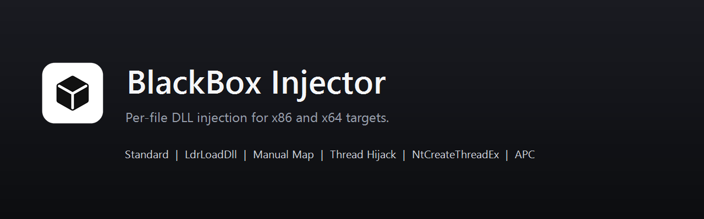
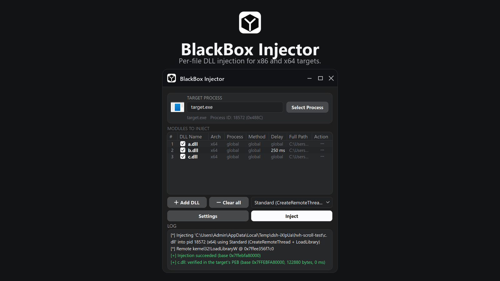
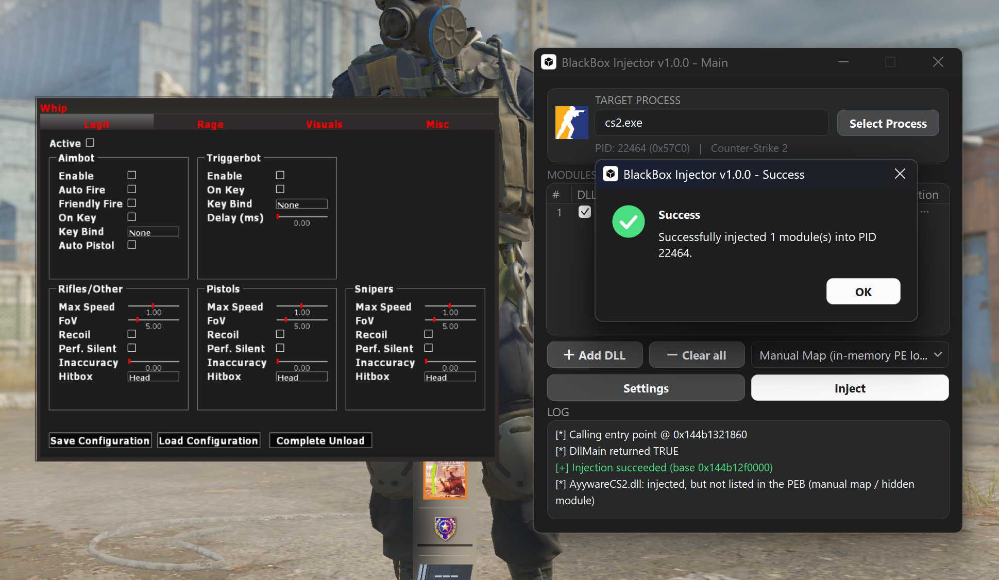
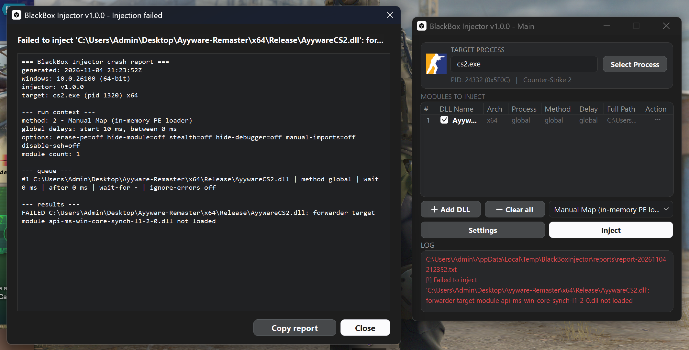

<p align="center">
  
</p>

> **Repository Notice:** This GitHub repository is dedicated exclusively to the open-source codebase, tracking commits, code review, pull requests, and technical issue/bug reports. 
> Precompiled binary releases, setup tutorials, usage discussion, and community support are hosted on the forum: **[hackvshack.net](https://hackvshack.net)** (Official Release Thread: **[BlackBox - Advanced Windows DLL Injector](https://hackvshack.net/threads/blackbox-advanced-windows-dll-injector-6-injection-methods-crash-triage-open-source.14818/)**).

# BlackBox Injector

<p align="center">
  
  
  
</p>

Native Windows DLL injection and diagnostic tool written in pure Rust. Supports native x64 and 32-bit WOW64 processes with 6 injection methods, in-memory cloaking, automated crash diagnostics, and scriptable CLI automation.

## Requirements

- Windows 10 / 11 (x64)
- Administrator privileges (for `SeDebugPrivilege` and cross-process handle acquisition)
- Rust 1.70+ and MSVC C++ Build Tools (only required to compile from source)

## Quick Start

### 1. Interactive GUI Mode
Launch `BlackBoxInjector.exe` with no arguments:
- Accept the UAC prompt (requests `requireAdministrator` via embedded manifest).
- Click **Select Process** to filter running processes by name or PID (auto-detects x86 / x64 architecture).
- Click **+ Add DLL** to queue one or multiple modules.
- Configure execution order, delays, and methods directly in the queue table.
- Click **Inject** to dispatch the queue.

### 2. Headless CLI / Automation Mode
BlackBox automatically detects command-line flags and attaches directly to the calling parent console:

```cmd
# Print every command and option
BlackBoxInjector.exe --help

# List every running process (PID, architecture, name)
BlackBoxInjector.exe --ps

# Inject queue into target by process name
BlackBoxInjector.exe --proc target.exe --inject

# Inject using Manual Map (method 2) into a specific PID
BlackBoxInjector.exe --pid 1337 --method 2 --inject

# Add a module to the persistent registry queue with a 500ms delay
BlackBoxInjector.exe --add C:\modules\hook.dll --delay 500

# Inspect active injection queue
BlackBoxInjector.exe --list

# Validate the queue against a target before injecting
BlackBoxInjector.exe --proc target.exe --validate
```

## How It Works: Injection Methods

### Method 0: Standard (CreateRemoteThread)
- Allocates memory for the DLL path in the target process via `VirtualAllocEx(PAGE_READWRITE)`.
- Writes the UTF-16 path via `WriteProcessMemory`.
- Resolves `kernel32.dll!LoadLibraryW` from the target's export table and spawns execution via `CreateRemoteThread`.

### Method 1: LdrLoadDll
- Bypasses user-mode hooks placed on `kernel32!LoadLibraryW` by interacting directly with the native NT loader.
- Formats a remote `UNICODE_STRING` buffer pointing to the module path.
- Spawns a remote thread invoking `ntdll.dll!LdrLoadDll` to load the DLL directly into the process loader list.

### Method 2: Manual Map (In-Memory PE Loader)
- Fully maps PE32 (x86) and PE32+ (x64) binaries in memory without calling the Windows module loader:
  - **Validation first:** `SizeOfImage`, every section's raw range, the entry point and the import/TLS tables are bounds-checked before a single byte reaches the target. A malformed file is a clean error, never a crash.
  - **Memory Allocation:** Computes `SizeOfImage` and allocates target virtual memory with `PAGE_EXECUTE_READWRITE`.
  - **Section Mapping:** Copies headers and iterates `IMAGE_SECTION_HEADER` entries, copying section raw data to their respective virtual addresses. Sections with no raw data are skipped, never silently truncated.
  - **Base Relocations:** Traverses `IMAGE_DIRECTORY_ENTRY_BASERELOC`, applying delta fixups (`IMAGE_REL_BASED_DIR64` / `HIGHLOW`) locally in memory before writing.
  - **Import Resolution:** Parses `IMAGE_DIRECTORY_ENTRY_IMPORT`, walks Import Address Tables (IAT), recursively resolves forwarded exports (`ntdll.RtlXxx`), and maps dependencies via remote export directory inspection and PEB `ApiSetMap` lookup (`api-ms-win-*` -> host module). Imports are always resolved against the *target's* export tables.
  - **Protections:** Each section receives its final protection (RX/RW/RO/NOACCESS) *before* any of the image runs; the header page ends up read-only.
  - **Exception data (x64):** The image's `.pdata` is registered with `RtlAddFunctionTable`, and the image is also inserted into `ntdll!KiUserInvertedFunctionTable` (the table `RtlPcToFileHeader` and the MSVC C++ runtime read). That makes both `__try/__except` and C++ `throw`/`catch` work inside a manually mapped module - without it the C++ runtime cannot resolve its FuncInfo RVAs and a `throw` terminates the target.
  - **TLS:** A real, minimal helper module (`assets/tls_seed.dll`, embedded in the injector) carries the payload's TLS template and is loaded into the target; the loader assigns the index and fills a block for **every** thread - including threads that already exist and threads the payload creates later. The payload's `AddressOfIndex` is pointed at that loader index and its TLS callbacks run before `DllMain`. This is what makes `thread_local` work on worker threads the payload spawns after initialisation.
  - **Entry Point:** Dispatches the module's `DllMain(DLL_PROCESS_ATTACH)` via a native remote stub. `AddressOfEntryPoint == 0` (resource-only DLL) is skipped, and a `FALSE` return is treated as a failed load (the image is freed again).

### Method 3: Thread Hijacking
- Enumerates candidate threads via `NtQueryInformationThread`, preferring ones started in the main executable, and tries them in order.
- Suspends a candidate, captures its context via `GetThreadContext`, redirects the instruction pointer to a loader stub and resumes it.
- The stub executes `LoadLibraryW`, sets a completion flag and **spins** (both bitnesses); the injector then suspends the thread and restores the saved context before freeing the stub. That is what keeps the target from replaying 100+ ms of application code.
- A thread parked in a kernel wait never runs the stub: its context is restored and the next candidate is tried. If a timeout happens while the thread is already inside `LoadLibrary`, the thread is left untouched and a hard error is reported instead of abandoning the loader lock.

### Method 4: NtCreateThreadEx
- Invokes undocumented native syscall `ntdll!NtCreateThreadEx`.
- Passes the `THREAD_CREATE_FLAGS_HIDE_FROM_DEBUGGER` creation flag to shield injection threads from attached debuggers and instrumentation engines.

### Method 5: APC (QueueUserAPC)
- Threadless injection: enumerates existing threads in the target process.
- Queues a call to `LoadLibraryW` with the remote path pointer using `QueueUserAPC`.
- Payload executes when the target thread enters an alertable wait state (`SleepEx`, `WaitForSingleObjectEx`).

## Injection method support matrix

Legend: **✅** supported and verified | **⚠️** supported with a caveat (see notes below) | **➖** not applicable to that method | **❌** not supported (reported as a clean error, target is left untouched).

### Target and DLL compatibility

| Capability | `0` Standard | `1` LdrLoadDll | `2` Manual Map | `3` Hijack | `4` NtCreateThreadEx | `5` APC |
| :--- | :---: | :---: | :---: | :---: | :---: | :---: |
| **x64 target** | ✅ | ✅ | ✅ | ✅ | ✅ | ✅ |
| **32-bit (WOW64) target** | ✅ | ✅ | ✅ | ✅ | ✅ | ❌ ¹ |
| **Static TLS** (`__declspec(thread)`) | ✅ | ✅ | ✅ ² | ✅ | ✅ | ✅ |
| **TLS callbacks** (`.CRT$XLB`) | ✅ | ✅ | ✅ | ✅ | ✅ | ✅ |
| **SEH** (`__try` / `__except`) inside the DLL | ✅ | ✅ | ⚠️ ³ | ✅ | ✅ | ✅ |
| **C++ exceptions** (`throw` / `catch`) | ✅ | ✅ | ⚠️ ³ | ✅ | ✅ | ✅ |
| **Delay-loaded imports** | ✅ | ✅ | ✅ | ✅ | ✅ | ✅ |
| **API-set imports** (`api-ms-win-*`) | ✅ | ✅ | ✅ | ✅ | ✅ | ✅ |
| **Forwarded exports** | ✅ | ✅ | ✅ | ✅ | ✅ | ✅ |
| **CFG-instrumented DLL** (`/guard:cf`) | ✅ | ✅ | ✅ | ✅ | ✅ | ✅ |
| **No entry point** (`/NOENTRY`, resource-only) | ✅ | ✅ | ✅ | ✅ | ✅ | ✅ |
| **`DllMain` returns `FALSE`** -> reported as a failed load | ✅ | ✅ | ✅ | ✅ | ✅ | ✅ |
| **Slow `DllMain`** (> 5 s) | ✅ | ✅ | ✅ ⁴ | ⚠️ ⁵ | ✅ | ✅ |
| **Forwarded imports** (`kernel32!InitOnceExecuteOnce` -> `api-ms-win-core-*`) | ✅ | ✅ | ✅ ¹² | ✅ | ✅ | ✅ |
| **Two DLLs with static TLS manual-mapped in one process** | ✅ | ✅ | ✅ ¹³ | ✅ | ✅ | ✅ |

> **Manual map on CS2:** works because the image never enters the loader's module lists (nothing for Trusted Mode to reject) and the mapper now replicates the loader bookkeeping payloads need; earlier injectors failed here because they could not resolve `api-ms-win-core-*` forwarded imports and were capped at 32 TLS slots (this process needs `_tls_index` 75) - no `-allow_third_party_software` and no standard-injection workaround required (verified with a 194-import SEH+TLS payload, game stayed up; inject after the game has fully loaded - use the queue wait/delay options).


### Options and cloaking

| Option | `0` Standard | `1` LdrLoadDll | `2` Manual Map | `3` Hijack | `4` NtCreateThreadEx | `5` APC |
| :--- | :---: | :---: | :---: | :---: | :---: | :---: |
| **Erase PE headers** | ✅ | ✅ | ✅ | ✅ | ✅ | ✅ |
| **Hide module** (PEB unlink + name blank) | ✅ | ✅ | ➖ ⁶ | ✅ | ✅ | ✅ |
| **ThreadHideFromDebugger** | ✅ | ✅ | ✅ ⁷ | ✅ ⁸ | ✅ | ➖ ⁹ |
| **Stealth inject** (erase + hide + hide thread) | ✅ | ✅ | ⚠️ ⁶ | ✅ | ✅ | ✅ |
| **Unload / eject** | ✅ | ✅ | ❌ ¹⁰ | ✅ | ✅ | ✅ |
| **PE Scrambler** (13 options) | ✅ | ✅ | ✅ | ✅ ¹¹ | ✅ | ✅ |
| **Queue options** (delay, per-file method, conditions, retries) | ✅ | ✅ | ✅ | ✅ | ✅ | ✅ |

### Notes & Limitations

1. **APC on WOW64 is not possible:** A 64-bit process cannot queue a 32-bit routine onto a WOW64 thread; the 32-bit APC dispatcher faults (verified). 32-bit targets receive a clean error instead of a crashing target - use methods 0-4. APC also requires the target thread to enter an alertable wait state (`SleepEx`, `WaitForSingleObjectEx`).
2. **Manual Map + Static TLS (`__declspec(thread)`):** TLS is loader-managed. A real, minimal helper module (`assets/tls_seed.dll`, embedded) carrying the payload's TLS template is loaded into the target, so the loader assigns a genuine `_tls_index` and fills a block for **every** thread - including threads created after injection. The payload's `AddressOfIndex` is pointed at that index and its TLS callbacks run before `DllMain`; no manual thread-array replacement is performed (that raced with the game's thread churn). Trade-off: the helper stays in the target's module list (loader-visible); its temp file is deleted after load. On 32-bit targets manual map still refuses a DLL with static TLS.
3. **Manual Map + Exceptions (x64 vs WOW64):** On x64, SEH and C++ exceptions work: `.pdata` is registered via `RtlAddFunctionTable` and the image is added to `ntdll!KiUserInvertedFunctionTable` (used by `RtlPcToFileHeader` and the MSVC C++ runtime). On WOW64, the 32-bit dispatcher only accepts exception handlers from loader-registered modules; manual map refuses 32-bit images with exception directories. Use loader methods (0, 1, or 4) for 32-bit DLLs using exceptions.
4. **Slow `DllMain` (> 60 s):** A `DllMain` exceeding the 60 s wait is reported as a failure and the mapped image is kept in target memory - it is never freed under a thread that may still be running inside it.
5. **Hijack Stub Timeout (10 s):** Hijack waits 10 s for its stub. If `DllMain` blocks longer than that, context cannot be restored without risking loader lock deadlock; the thread is left untouched, a hard error is returned, and the target must be restarted.
6. **HideModule PEB Unlinking:** Manually mapped modules are not registered in PEB loader lists, so `HideModule` has nothing to unlink (`ErasePE` still applies). For loader methods, `HideModule` unlinks `InLoadOrderModuleList`, `InMemoryOrderModuleList`, and `InInitializationOrderModuleList` and blanks module names (defeating `EnumProcessModules` and name walks); the loader internal hash table still contains the entry.
7. **Debugger Masking (ThreadHide):** The injector's initialization threads (including TLS callback threads) are created with `THREAD_CREATE_FLAGS_HIDE_FROM_DEBUGGER`.
8. **Hijack Thread Debugger Masking:** Applied to the hijacked thread via `NtSetInformationThread(ThreadHideFromDebugger)` once original execution context is restored.
9. **APC Thread Masking:** APC queues onto existing target threads and creates no thread of its own, so thread hiding is not applicable.
10. **Unload / Eject:** Manually mapped modules register no OS loader bookkeeping, so `FreeLibrary` cannot eject the image; BlackBox reports this directly instead of failing silently.
11. **PE Scrambler:** Hijack loads the temporary scrambled copy. `ShiftSectionMemory` is intentionally bypassed with a clear warning because section memory shifting requires complete PE RVA rebasing.
12. **Forwarded imports:** manual map resolves API-set contracts through the target's `ApiSetMap` (schema v6: 28-byte header, `EntryOffset` 0x1C, name compared up to the last hyphen because the schema stores revision `-l1-2-1` while binaries reference `-l1-2-0`, host DLL taken from `_API_SET_VALUE_ENTRY_V6.ValueOffset`). Verified in live CS2 with `kernel32!InitOnceExecuteOnce`, `InitOnceBeginInitialize` and `SleepConditionVariableCS`.
13. **Multiple manual-mapped DLLs with static TLS:** every map loads its own TLS seed, so each manually mapped module receives a distinct loader-assigned `_tls_index` (verified: two TLS DLLs mapped into one process got indices 74 and 75 and both kept working). Loader methods are unaffected.

**Verified on** Windows 10 IoT Enterprise LTSC 2024 (build 26100.7462) x64 with WOW64, against a purpose-built matrix of test DLLs (plain, TLS variables + callbacks, a DLL whose `DllMain` spawns a worker thread that reads `thread_local`, SEH + C++ exceptions, static CRT/STL, delay-load, API-set imports, CFG, `/NOENTRY`, `DllMain FALSE`, 8 s and 12 s `DllMain`, crash-on-attach) and both 64-bit and 32-bit targets - plus a live **CS2** (`cs2.exe`, x64, elevated): a TLS DLL at a loader-assigned index, a DLL importing three API-set forwarders (`first=1 runs=1 second=1`), a second manual-mapped TLS DLL receiving a distinct index, and a 194-import payload with SEH + TLS - the game stayed alive with no crash record, and the TLS seed was verified to fill blocks for pre-existing and newly created threads.

## Stealth & Memory Cloaking

- **PE Header Zeroing (`ErasePE`):** Makes the header page writable with `VirtualProtectEx`, zeroes the DOS signature (`MZ`), NT headers and section table, restores the protection and verifies the write. Works for loader-mapped *and* manually mapped modules.
- **PEB Loader Unlinking (`HideModule`):** Traverses the remote Process Environment Block (`PEB->Ldr`), unlinks the module's `LDR_DATA_TABLE_ENTRY` from all three doubly-linked lists (`InLoadOrderModuleList`, `InMemoryOrderModuleList`, `InInitializationOrderModuleList`) and blanks its name lengths so name-based lookups miss it. The loader's internal hash table still references the entry, so this defeats enumeration (`EnumProcessModules`, module walks), not a direct hash-table walk.
- **Debugger Masking (`ThreadHide`):** Passes `THREAD_CREATE_FLAGS_HIDE_FROM_DEBUGGER` to new threads and calls `NtSetInformationThread(ThreadHideFromDebugger)` on the hijacked thread (hijacking creates no new thread of its own).
- **PE Scrambler Engine:** Applies local binary transformations before memory transfer (section names, header fields, timestamps, debug data, import order, padding bytes, decoy sections, entry trampoline), keeping the result loadable through both the loader and the manual mapper. `ShiftSectionMemory` needs a full PE rebase, so it is skipped with an explicit warning instead of producing a corrupt image.

## Diagnostic & Post-Mortem Analysis


*Example: Injecting a 64-bit module (`AyywareCS2.dll`) into Counter-Strike 2 (`cs2.exe`) generates an automated failure report via Manual Map because an API-set forwarder dependency (`api-ms-win-core-synch-l1-2-0.dll`) is not loaded in the remote process.*

- **Automated Crash Diagnostics (WER Event Analysis):** When a target process terminates unexpectedly after injection, BlackBox maintains an independent surviving process query handle (`PROCESS_QUERY_LIMITED_INFORMATION | SYNCHRONIZE`), reads the NT exit code, queries the Windows Application Event Log (`Event ID 1000 Application Error` and `1001 Windows Error Reporting`), and generates an automated triage report (`%TEMP%\BlackBoxInjector\reports\crash-*.txt`):
  - **Fault Attribution:** Distinguishes whether the crash occurred inside the host executable (e.g. `target.exe`), one of the injected payloads (e.g. `payload.dll`), or an external system/overlay runtime (`ntdll`, `kernelbase`, graphics hook).
  - **Disassembly Triage Hints:** Translates fault offsets into Relative Virtual Addresses (RVA) from the module base, providing developers with the exact address (`ImageBase + RVA`) to jump to in IDA Pro, Ghidra, or x64dbg.
  - **Exception Code Decoding:** Translates raw NTSTATUS codes into actionable failure causes:
    - `0xC0000005` (Access Violation): Identifies invalid memory read/write operations; automatically flags offsets `< 0x1000` as NULL page dereferences (uninitialized pointers or virtual function calls).
    - `0xC0000409` (Fail-Fast / Stack Buffer Overrun): Identifies Control Flow Guard (CFG) violations, corrupted `/GS` security cookies (`__security_check_cookie`), or explicit `__fastfail()` invocations.
    - `0xC00000FD` (Stack Overflow): Flags thread stack exhaustion caused by recursive hooks or large stack allocations.
    - `0xC0000142` (DLL Initialization Failed): Flags `DllMain` returning `FALSE` or unhandled exceptions thrown during TLS callbacks or static CRT initialization.
    - `0xC0000374` (Heap Corruption): Flags heap metadata corruption, double-frees, or cross-allocator mismatches.
    - `0xC0000135` / `0xC0000139`: Identifies missing dependent DLLs or missing ordinal/named exports.
  - **Timing & Lifetime Analysis:** Differentiates immediate initialization failures (`< 1500 ms`) in `DllMain` from post-injection crashes triggered during standard application execution.
- **Pre-Injection PE & Dependency Scanner:**
  - Validates PE architecture, machine type, image base, entry point, TLS callback count, and section boundaries.
  - Inspects base relocations (`IMAGE_DIRECTORY_ENTRY_BASERELOC`), warning developers if relocations are stripped (which causes manual map failure if the preferred image base is occupied).
  - Audits binary security mitigations (`ASLR`, `DEP`, `Control Flow Guard`, `No SEH`).
  - Scans the Import Address Table (IAT) against the target address space, resolving API sets (`api-ms-win-*`) and System32 availability.
- **VC++ Runtime Detection & 1-Click Installer:**
  - Injected DLLs compiled with MSVC often require Visual C++ Redistributable runtime DLLs (`vcruntime140.dll`, `msvcp140.dll`).
  - BlackBox inspects **both** registry views (`HKLM\SOFTWARE\Microsoft\VisualStudio\14.0\VC\Runtimes` in the 64-bit view and in `WOW6432Node`, where the x86 redistributable registers itself) and falls back to the runtime DLLs in `System32` / `SysWOW64`.
  - When injecting a DLL that imports missing VC++ dependencies, an interactive prompt allows users to install the official Microsoft runtime in 1 click or cancel and proceed. Every subsequent injection attempt without the runtime installed prompts again. In headless CLI mode, `--install-redist` is the scriptable path.
- **Real-Time Event Stream:** Built-in virtual console displaying color-coded status prefixes (`[+]` success, `[*]` info, `[-]` warning, `[!]` error) with multi-line selection and clipboard copy.

## Reporting Issues

Bug reports and technical issues are tracked exclusively via **[GitHub Issues](https://github.com/plisskien/BlackBox-DLL-Injector/issues)**. Please do not report bugs on forum threads - reporting on GitHub ensures crashes and diagnostic dumps can be triaged and resolved directly in source code.

When opening an issue, please copy and fill out the template below:

````markdown
### Environment
- OS: [e.g. Windows 11 24H2 Build 26100]
- Target Process: [e.g. game.exe (x64) / app.exe (WOW64)]
- Injection Method: [e.g. Method 2 - Manual Map]
- Mode: [GUI / CLI]

### Description
[Describe the bug: error code, target crash, freeze, or unexpected behavior]

### Diagnostic Report
<!-- Click "Copy report" in the failure/crash dialog or copy from %TEMP%\BlackBoxInjector\reports\ -->
```text
=== BlackBox Injector crash report ===
[Paste report here]
```

### Activity Log
```text
[Paste UI virtual console or terminal log here]
```
````
